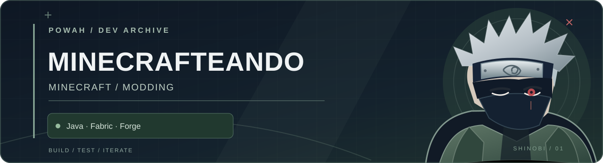

<p align="center">
  <strong>Minecraft modding · Java · Fabric · Forge</strong>
</p>

<p align="center">
  <a href="mods/fabric/primer-mod/">Tomatazo</a> ·
  <a href="mods/forge/">Mods Forge</a> ·
  <a href="apuntes/plan-aprendizaje-modding.md">Apuntes</a>
</p>

---

Un repositorio para mis mods de Minecraft. Aquí guardo tanto el código que estoy aprendiendo a manejar como las versiones y pruebas de otros proyectos.

## Proyectos

| Proyecto | Qué hay disponible |
| :-- | :-- |
| **[Tomatazo](mods/fabric/primer-mod/)** | Código Java y recursos de un cultivo de tomates. Se pueden plantar, comer y lanzar. Incluye capturas. |
| **[Mods Forge 1.20.1](mods/forge/)** | Documentación de Gremlin, Ruby/REFORCED, Mochilas + Hornos y Mazmorras de Duendes. Los JAR originales no están publicados aquí. |

## Estructura

```text
mods/
├── fabric/
│   └── primer-mod/     # Tomatazo, código y recursos
└── forge/              # Documentación de los mods Forge
apuntes/                # Notas de aprendizaje
```

## Compilar Tomatazo

Necesitas el JDK que pide el proyecto y conexión para descargar las dependencias de Gradle.

```bash
cd mods/fabric/primer-mod
./gradlew build
```

Si la compilación termina bien, encontrarás los archivos generados en `build/libs/`.

## Próximos pasos

Quiero seguir practicando Java, mejorar las mecánicas que ya tengo y probar la compatibilidad de los mods en instalaciones reales. También tengo pendiente recuperar las fuentes de los proyectos Forge, no solo sus binarios.

---

<sub>Identidad visual inspirada en Kakashi: grafito, verde apagado y detalles plata. Ilustración vectorial original para estos proyectos.</sub>
