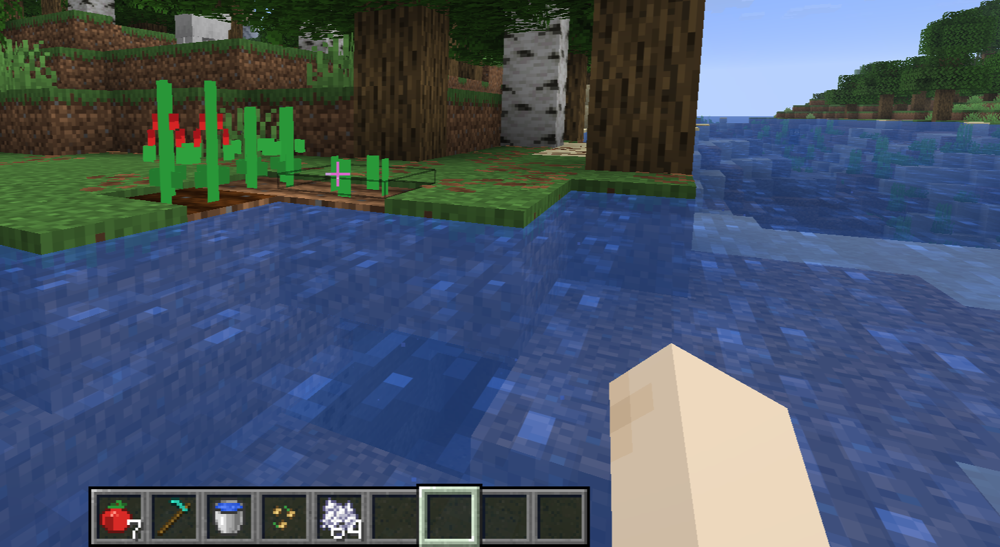
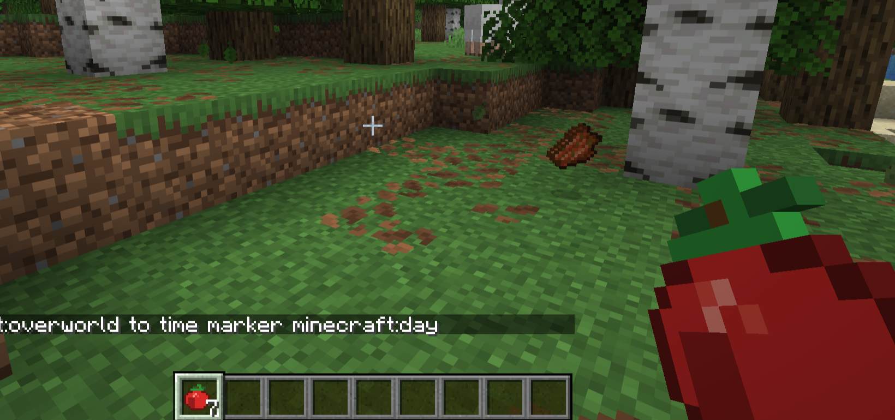

# Tomatazo

Un mod de Fabric para añadir tomates a Minecraft. Puedes cultivarlos, comerlos y también tirárselos a otras entidades.

## Qué lleva

- Semillas que pueden encontrarse en cofres de aldeas.
- Cultivo en tierra arada, con crecimiento y uso de polvo de hueso.
- Cosecha madura que deja **2–5 tomates** y **2–3 semillas**. Antes de madurar, devuelve una semilla.
- Tomates comestibles.
- Lanzamiento con **Shift + clic derecho**. El proyectil aplica efectos al impactar en determinadas zonas de una entidad.
- Texturas, modelos y nombres en español e inglés.

## Código

El proyecto está hecho con Java, Fabric API y Gradle. Puedes revisar las clases de los ítems, el cultivo y el proyectil en `src/main/java/`, y sus recursos en `src/main/resources/`.

Para compilarlo desde esta carpeta:

```bash
./gradlew build
```

Hace falta tener instalado el JDK adecuado para la versión del proyecto. La compilación y el funcionamiento en el juego son comprobaciones distintas.

El proyecto utiliza Java 25. La [compilación automática](../../../.github/workflows/tomatazo-build.yml) comprueba el código con Gradle y, cuando termina correctamente, permite descargar los JAR generados desde GitHub Actions. Un JAR compilado no garantiza que el mod funcione en el juego; aún necesita pruebas dentro de Minecraft. La automatización comprueba además que el JAR final incluya los puntos de entrada Java, el icono, las traducciones y los modelos básicos del mod.

## Capturas




